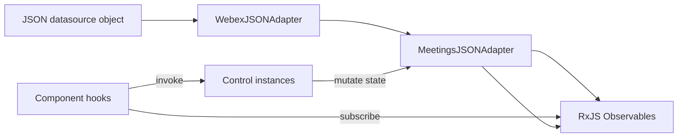
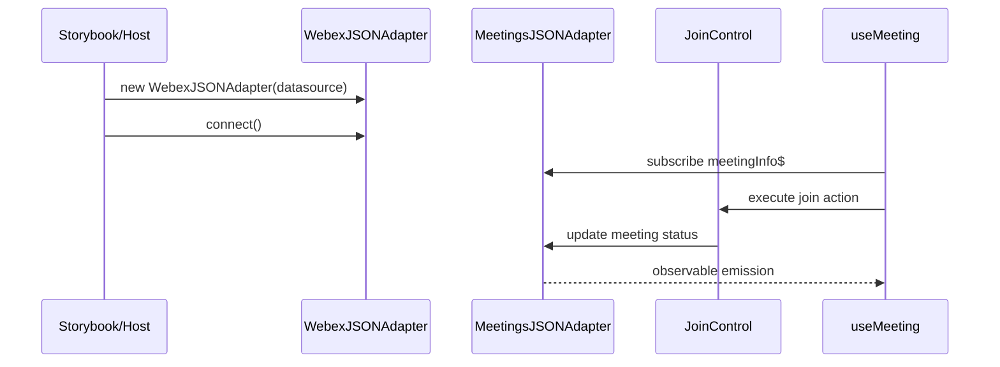
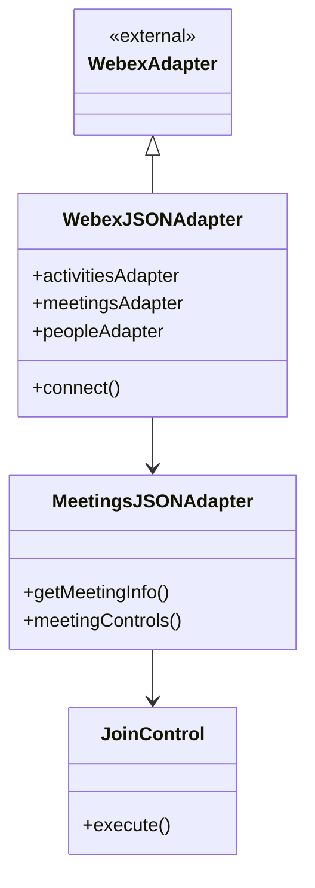

# adapters — SPEC

> Start here → root [`AGENTS.md`](../../../AGENTS.md) · router [`SPEC_INDEX.md`](../../../ai-docs/SPEC_INDEX.md) · system [`ARCHITECTURE.md`](../../../ai-docs/ARCHITECTURE.md).

## Metadata

| Field | Value |
|---|---|
| Module id | adapters |
| Source path(s) | `src/adapters/` |
| Doc kind | Module spec |
| Coverage score | 97% assessed 2026-07-23 — all domain adapters and meeting controls documented |
| Generated from | `module-spec` @ SDLC template library `0.2.1` |
| generated_by / approved_by / updated_at | cursor-agent-session / pending PR approval / 2026-07-23 |
| Validation status | not-run |

## Evidence Rules

Requirements cite adapter source and co-located `*.test.js` files. Observable behavior validated against `@webex/component-adapter-interfaces` types.

## Source Material Register

| Source material | Scope | Decision | Detail location |
|---|---|---|---|
| `@webex/component-adapter-interfaces` | adapter API | reference-only | Requires section; npm package |
| JSON fixtures | demo data | verified | `src/data/*.json` if present |

## Overview

The **adapters** module provides JSON-backed implementations of Webex component adapter interfaces for offline development, Storybook, and tests. `WebexJSONAdapter` is the façade that wires domain-specific JSON adapters (meetings, people, rooms, activities, memberships, organizations).

`MeetingsJSONAdapter` is the largest adapter — it models meeting state, media streams, roster, settings, and meeting controls as RxJS observables with control class instances.

## Purpose / Responsibility

Supply in-memory/Webex-shaped data and control semantics to React components without a live Webex SDK connection. Does **not** implement network I/O or token management.

## Stack

- JavaScript ES modules
- RxJS (`Observable`, operators) for reactive meeting/people streams
- Extends classes from `@webex/component-adapter-interfaces`
- Jest tests co-located with adapters

## Folder / Package Structure

```
src/adapters/
├── WebexJSONAdapter.js           # Root JSON adapter façade
├── MeetingsJSONAdapter.js        # Meetings domain + controls
├── MeetingsJSONAdapter/controls/ # Join, mute, share, roster, … controls
├── PeopleJSONAdapter.js
├── RoomsJSONAdapter.js
├── ActivitiesJSONAdapter.js
├── MembershipJSONAdapter.js
├── OrganizationsJSONAdapter.js
├── index.js                      # Public exports
└── *.test.js                     # Domain adapter tests
```

## Key Files (source of truth)

| File | Holds |
|---|---|
| `src/adapters/WebexJSONAdapter.js` | Façade wiring datasource keys to domain adapters |
| `src/adapters/MeetingsJSONAdapter.js` | Meeting state machine, observables, control registry |
| `src/adapters/MeetingsJSONAdapter/controls/index.js` | Control exports |
| `src/adapters/index.js` | Public adapter exports |
| `src/util.js` | `deepMerge` used by MeetingsJSONAdapter |

## Public Surface

| Contract ID | Type | Surface | Purpose | Compatibility | Detail link | Root index |
|---|---|---|---|---|---|---|
| adapters.WebexJSONAdapter | SDK export | class | Entry JSON adapter | Semver | `src/adapters/WebexJSONAdapter.js` | `ai-docs/CONTRACTS.md` |
| adapters.MeetingsJSONAdapter | SDK export | class | Meeting observables + controls | Semver | `src/adapters/MeetingsJSONAdapter.js` | `ai-docs/CONTRACTS.md` |
| adapters.PeopleJSONAdapter | SDK export | class | People search/display data | Semver | `src/adapters/PeopleJSONAdapter.js` | `ai-docs/CONTRACTS.md` |
| adapters.RoomsJSONAdapter | SDK export | class | Space/room data | Semver | `src/adapters/RoomsJSONAdapter.js` | `ai-docs/CONTRACTS.md` |
| adapters.ActivitiesJSONAdapter | SDK export | class | Activity stream data | Semver | `src/adapters/ActivitiesJSONAdapter.js` | `ai-docs/CONTRACTS.md` |
| adapters.MembershipJSONAdapter | SDK export | class | Membership/roster data | Semver | `src/adapters/MembershipJSONAdapter.js` | `ai-docs/CONTRACTS.md` |
| adapters.OrganizationsJSONAdapter | SDK export | class | Organization data | Semver | `src/adapters/OrganizationsJSONAdapter.js` | `ai-docs/CONTRACTS.md` |

## Requires (dependencies)

- `@webex/component-adapter-interfaces` — base adapter classes, `MeetingState`, control interfaces
- `rxjs` — observables and operators
- `src/util.js` — `deepMerge` for meeting state updates
- Datasource object with keys: `activities`, `meetings`, `memberships`, `organizations`, `people`, `rooms`

Evidence: `src/adapters/WebexJSONAdapter.js` constructor.

## Requirements

| ID | WHAT | WHY | Source Evidence | Test Evidence | Gaps | Confidence |
|---|---|---|---|---|---|---|
| ADP-R-001 | `WebexJSONAdapter` MUST extend `WebexAdapter` and construct six domain adapters | Single entry point for JSON demo data | `src/adapters/WebexJSONAdapter.js` | adapter integration tests | none | PRESENT |
| ADP-R-002 | `connect()` / `disconnect()` MUST resolve immediately for JSON adapters | No async network | `src/adapters/WebexJSONAdapter.js` | — | none | PRESENT |
| ADP-R-003 | `MeetingsJSONAdapter` MUST expose meeting control constants (join, mute, share, …) | UI maps controls by ID | `src/adapters/MeetingsJSONAdapter.js` | `src/adapters/MeetingsJSONAdapter.test.js` | none | PRESENT |
| ADP-R-004 | Meeting state updates MUST use RxJS observables | Components subscribe via hooks | `src/adapters/MeetingsJSONAdapter.js` | MeetingsJSONAdapter tests | none | PRESENT |
| ADP-R-006 | Datasource MUST provide keys: activities, meetings, memberships, organizations, people, rooms | WebexJSONAdapter constructor contract | `src/adapters/WebexJSONAdapter.js` | adapter tests | none | PRESENT |
| ADP-R-007 | Each domain adapter MUST extend matching interface adapter class | Interface compliance | `src/adapters/PeopleJSONAdapter.js` | PeopleJSONAdapter.test.js | none | PRESENT |

## Meeting Controls Registry

| Control constant | Control class | Purpose |
|---|---|---|
| `JOIN_CONTROL` | `JoinControl` | Join meeting |
| `LEAVE_CONTROL` | `LeaveControl` | Leave meeting |
| `MUTE_AUDIO_CONTROL` | `MuteAudioControl` | Toggle audio mute |
| `MUTE_VIDEO_CONTROL` | `MuteVideoControl` | Toggle video mute |
| `SHARE_CONTROL` | `ShareControl` | Screen share |
| `ROSTER_CONTROL` | `RosterControl` | Toggle roster |
| `SETTINGS_CONTROL` | `SettingsControl` | Open settings |
| `SWITCH_CAMERA_CONTROL` | `SwitchCameraControl` | Switch camera device |
| `SWITCH_MICROPHONE_CONTROL` | `SwitchMicrophoneControl` | Switch microphone |
| `SWITCH_SPEAKER_CONTROL` | `SwitchSpeakerControl` | Switch speaker |
| `DISABLED_MUTE_AUDIO_CONTROL` | `DisabledMuteAudioControl` | Disabled mute state |
| `DISABLED_JOIN_CONTROL` | (disabled join) | Disabled join state |

Evidence: `src/adapters/MeetingsJSONAdapter.js`, `src/adapters/MeetingsJSONAdapter/controls/`.

## Domain Adapter Summary

| Adapter | Source file | Test file |
|---|---|---|
| ActivitiesJSONAdapter | `src/adapters/ActivitiesJSONAdapter.js` | `ActivitiesJSONAdapter.test.js` |
| MeetingsJSONAdapter | `src/adapters/MeetingsJSONAdapter.js` | `MeetingsJSONAdapter.test.js` |
| MembershipJSONAdapter | `src/adapters/MembershipJSONAdapter.js` | `MembershipJSONAdapter.test.js` |
| OrganizationsJSONAdapter | `src/adapters/OrganizationsJSONAdapter.js` | `OrganizationsJSONAdapter.test.js` |
| PeopleJSONAdapter | `src/adapters/PeopleJSONAdapter.js` | `PeopleJSONAdapter.test.js` |
| RoomsJSONAdapter | `src/adapters/RoomsJSONAdapter.js` | `RoomsJSONAdapter.test.js` |

## Module Conventions

- One adapter class per domain JSON file at `src/adapters/` root.
- Meeting controls as separate classes under `MeetingsJSONAdapter/controls/`.
- Use RxJS `Observable` for all adapter data streams.
- Use `deepMerge` from `src/util.js` for immutable-style state updates in meetings adapter.

## Design Trade-offs

- **In-memory JSON vs live SDK:** Simplifies Storybook/tests; behavior may diverge from production SDK adapter edge cases — hosts must validate against SDK adapter for production.
- **Synchronous connect/disconnect:** JSON adapter resolves immediately; SDK adapters may differ in timing — `withAdapter` handles async connect generically.

## Design Overview

JSON adapters mirror the SDK adapter shape so components do not branch on data source. `WebexJSONAdapter` delegates to focused adapters per domain. `MeetingsJSONAdapter` centralizes meeting lifecycle (NOT_JOINED → joined states), media permissions, roster visibility, and settings preview — emitting updates through observables consumed by component hooks.

Control objects encapsulate imperative actions (join, leave, mute audio/video, share screen, device switching) and mutate in-memory meeting state.

## Data Flow



## Sequence Diagram(s)



## Class / Component Relationships



## Use Cases

| UC | Description | Evidence |
|---|---|---|
| UC-1 Storybook demo | Instantiate `WebexJSONAdapter` with static JSON | `.storybook/` stories |
| UC-2 Unit test | Inject JSON adapter into `WebexDataProvider` | component tests |
| UC-3 Control interaction | User clicks join → `JoinControl` updates state | `MeetingsJSONAdapter/controls/JoinControl.js` |

## Concurrency & Reactive Flow

Meeting updates propagate via RxJS `Observable` streams. Multiple subscribers (hooks) share hot/cold patterns as implemented per adapter method — components must unsubscribe on unmount (handled in hooks).

Evidence: `src/adapters/MeetingsJSONAdapter.js`, rxjs imports.

## State Machine

Meeting status transitions include `NOT_JOINED` and joined/in-meeting states aligned with `MeetingState` from `@webex/component-adapter-interfaces`. Controls gate transitions (e.g. join, leave).

Evidence: `src/adapters/MeetingsJSONAdapter.js` `EMPTY_MEETING`, status field.

## Error Handling & Failure Modes

- JSON adapters resolve connect/disconnect without error paths for network.
- Invalid datasource keys may yield undefined adapter data — hosts must supply complete datasource shape.
- Control operations on invalid meeting IDs: behavior defined per control implementation; verify tests.

## Pitfalls

- Datasource must include all keys expected by `WebexJSONAdapter` constructor.
- Meeting control IDs are string constants — must stay aligned with component control bar mapping.
- `deepMerge` mutates destination objects — callers must pass clones if immutability required.

Evidence: `src/adapters/WebexJSONAdapter.js`, `src/util.js`.

## Test-Case Strategy (module)

- Domain tests: `MeetingsJSONAdapter.test.js`, `PeopleJSONAdapter.test.js`, etc.
- Assert observable emissions and control side effects.
- Mock datasource objects inline in tests.

Evidence: `src/adapters/*.test.js`.

## Traceability

| Requirement | Code | Tests |
|---|---|---|
| ADP-R-001 | `src/adapters/WebexJSONAdapter.js` | adapter tests |
| ADP-R-002 | `src/adapters/WebexJSONAdapter.js` | — |
| ADP-R-003 | `src/adapters/MeetingsJSONAdapter.js` | `MeetingsJSONAdapter.test.js` |
| ADP-R-004 | `src/adapters/MeetingsJSONAdapter.js` | MeetingsJSONAdapter tests |
| ADP-R-005 | `src/adapters/MeetingsJSONAdapter/controls/` | control tests |
